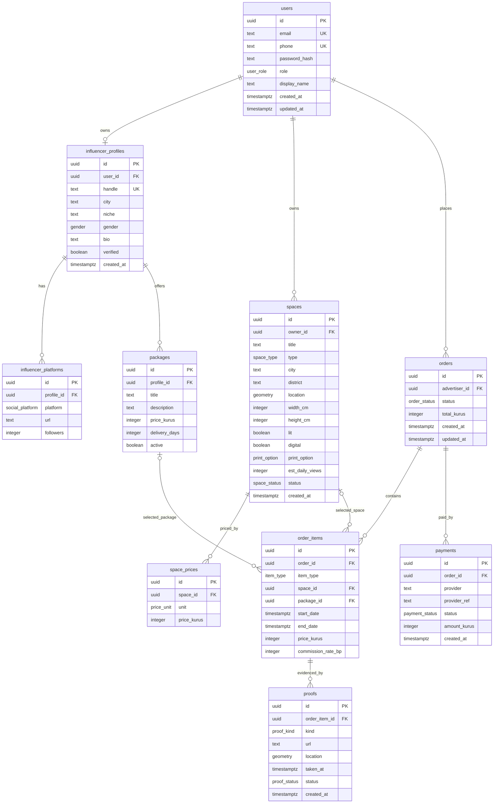

# Veritabanı

İlk şema PostgreSQL 16 ve PostGIS 3.4 üzerinde çalışır. Kimlik doğrulama, ödeme akışı ve sonraki faz tabloları bu ilk şemanın dışındadır.

Makinende 5432'yi başka bir PostgreSQL kullanıyorsa DB_PORT=55432 yap. DATABASE_URL içindeki portu da 55432 olarak güncelle.

## Tablolar

- `users`: rol, görünen ad, benzersiz küçük harf e-posta, isteğe bağlı benzersiz telefon ve kimlik sağlayıcısının ileride dolduracağı nullable parola hash'i.
- `influencer_profiles`, `influencer_platforms`, `packages`: üretici profili, sosyal hesap ve paket kataloğu. Profil silinince alt kayıtları cascade ile silinir.
- `spaces`, `space_prices`: fiziksel/dijital reklam alanları, WGS84 noktası ve GIST konum indeksi, satış birimi fiyatı. `spaces.created_at` oluşturulma zamanını `timestamptz` olarak tutar; fiyatlar alanla cascade silinir.
- `orders`, `order_items`, `payments`, `proofs`: sipariş, alan veya paket satırı, ödeme ve yayın kanıtı. Sipariş kalemleri sipariş silinince cascade silinir; ancak bağlı ödeme varsa `payments.order_id` restrict nedeniyle sipariş silinemez. Kalem silinince kanıtlar cascade silinir.

Tekillik kuralları: `users.email` küçük harfli olmalı ve benzersizdir; `users.phone`, `influencer_profiles.user_id`, `influencer_profiles.handle` benzersizdir. Platform başına profil, profil başına paket adı ve alan başına fiyat birimi bileşimleri de benzersizdir.

Boş bırakılabilen kolonlar: `users.phone`, `users.password_hash`, `order_items.space_id`, `order_items.package_id`, `payments.provider_ref` ve `proofs.location`. Sipariş kaleminde iki ürün kolonundan yalnızca biri dolu olmalıdır. Konum için `spaces.location` ve `proofs.location` üzerinde GIST indeksleri vardır.

Enum değerleri: `user_role` = `advertiser | influencer | space_owner | agency | admin`; `gender` = `female | male | other`; `social_platform` = `instagram | tiktok | youtube | x | linkedin | twitch | kick`; `space_type` = `billboard | megalight | clp | avm_led | avm_stand | dooh | vehicle | other`; `print_option` = `included | extra | advertiser`; `space_status` = `draft | pending | active | rejected`; `price_unit` = `day | week | two_weeks | month | spot | event`; `order_status` = `pending | accepted | live | proof_pending | approved | completed | cancelled | disputed`; `item_type` = `space | package`; `payment_status` = `initiated | held | released | refunded | failed`; `proof_kind` = `photo | video | link | screenshot`; `proof_status` = `submitted | approved | rejected`.

Kullanıcıya bağlı profil ve katalog kayıtları cascade davranışı kullanır. Sipariş veren kullanıcı, alan sahibi, sipariş kalemindeki alan/paket ve ödeme kaydı bulunan sipariş silme davranışı restrict'tir; finansal ve kanıt geçmişinin bağlı taraflar silinerek kaybolmaması için. Fiyatlar, sipariş kalemleri ve kalem altındaki kanıtlar sahip kaydı silinince cascade davranışı kullanır.

Tüm kimlikler UUID'dir. Para alanları kuruştur ve negatif değer kabul etmez. Kalemlerde yalnızca `item_type` ile uyumlu tek bir `space_id` ya da `package_id` bulunabilir. Sipariş tarih aralığı ve teslim süresi sınırları göçte CHECK kısıtlarıyla uygulanır. `db:reset` yalnız `localhost` veya `127.0.0.1` host'una bağlı `DATABASE_URL` ile çalışır; `public` ve Drizzle göç kaydı için kullanılan `drizzle` şemalarını silip göç ve seed'i baştan çalıştırır.
